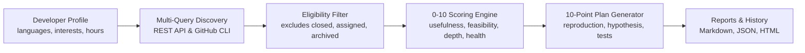

<div align="center">

# ContribScout 🧭

**Personalized open-source contribution discovery agent.**

[](https://github.com/udaydomadiya08/contribscout/actions/workflows/tests.yml)
[](https://www.python.org/downloads/)
[](LICENSE)
[](docs/privacy.md)

*Discover, evaluate, rank, and plan real GitHub contribution opportunities tailored to your skills, time, and goals.*

</div>

---

## 🎯 The Problem

Finding the right open-source issue to work on is surprisingly tedious:
- Most developers search the generic `good first issue` label, only to find issues that are already solved, abandoned, or assigned to someone else.
- Trivial tasks like 1-word typo fixes offer very little engineering growth or portfolio credibility.
- Complex architectural issues can quickly turn into overwhelming multi-week rabbit holes without maintainer support.
- Developers waste hours reading issues only to discover the repository is archived, the discussion has stalled, or the maintainers take months to review pull requests.

## 💡 The Solution: ContribScout

**ContribScout** is a local-first, privacy-conscious CLI application that acts as your personal contribution scout:
1. **Multi-Vector Discovery**: Searches GitHub across languages, frameworks, interests, bug reports, performance gaps, tests, and DX tasks.
2. **Eligibility & Freshness Filter**: Automatically discards closed issues, assigned tasks, merged solutions, archived projects, and stale repositories.
3. **Explainable 0–10 Scoring**: Ranks opportunities using a transparent mathematical formula based on usefulness, feasibility, technical depth, maintainer responsiveness, learning goals, and repository health.
4. **Actionable 10-Point Investigation Plans**: Generates concrete steps to reproduce the issue, what docs to read first, likely files to inspect, tests to write, and questions to ask maintainers.
5. **Multi-Format Reports**: Produces clean Markdown, structured JSON, or responsive standalone HTML reports.
6. **Local & Private**: No cloud backend, no account creation, no telemetry, and 100% functional without paid AI APIs.

---

## 🔄 How It Works



---

## 🚀 Quick Start

### 1. Prerequisites
- Python 3.10 or newer (tested on Python 3.10, 3.11, and 3.12).
- macOS, Linux, or Windows.
- Optional: Official GitHub CLI (`gh`).

### 2. Installation

Clone and install ContribScout in a virtual environment:

```bash
# Clone the repository
git clone https://github.com/udaydomadiya08/contribscout.git
cd contribscout

# Create and activate virtual environment
python3 -m venv .venv

# On macOS / Linux:
source .venv/bin/activate

# On Windows:
.venv\Scripts\activate

# Install ContribScout
pip install -e .
```

### 3. Verify Environment

Run the built-in diagnostic doctor:

```bash
contribscout doctor
```

```text
=== ContribScout Diagnostic Health Check ===
✓ Python runtime: 3.11.15 (>= 3.10 required)
✓ GitHub CLI (gh): Installed and authenticated
✓ GitHub Token: Detected (gho_****...****)
✓ GitHub API Connectivity: Connected successfully
  - Core API Rate Limit: 4997 / 5000 remaining
  - Search API Rate Limit: 30 remaining
============================================
```

### 4. Initialize Your Developer Profile

Create your personalized configuration file:

```bash
contribscout init
```

This creates a `profile.yaml` file in your workspace with sensible defaults and explanatory comments.

### 5. Run Your First Scan

Scan GitHub for opportunities matching your profile:

```bash
# Generate Markdown report to terminal
contribscout scan

# Or save an HTML report:
contribscout scan --format html --output reports/scan.html
```

Open `reports/scan.html` in your browser to inspect interactive contribution cards and 10-point investigation plans!

---

## ⚙️ Profile Configuration

Your profile configuration lives in `profile.yaml` (or custom path via `--profile`).

```yaml
# Programming languages and proficiency (beginner, intermediate, advanced, expert)
languages:
  python: advanced
  javascript: intermediate
  typescript: beginner

# Familiar frameworks & libraries
frameworks:
  - fastapi
  - pytorch
  - pytest
  - docker
  - numpy

# Technical domains of interest
interests:
  - ai/ml
  - developer tools
  - automation
  - backend
  - performance

# Preferred contribution types
contribution_types:
  - bug
  - performance
  - testing
  - dx
  - feature
  - good-first-issue

# Experience and time commitments
experience_level: intermediate
hours_per_week: 5.0
preferred_duration: medium  # quick (<3h), medium (3-10h), deep (10h+), any
desired_difficulty: intermediate

# Goals for learning and portfolio
learning_goals:
  - asyncio and concurrent programming
  - computer vision inference optimization
  - robust test suites and mocking patterns

# Minimum community adoption
min_stars: 50
max_stars: null

# Repositories or orgs to ignore
exclude_repos: []
exclude_orgs: []
exclude_topics:
  - tutorial
  - homework
exclude_labels:
  - wontfix
  - invalid
  - duplicate

# API limits & budget protection
max_candidates: 30
api_budget_requests: 60
rate_limit_pause_seconds: 1.0
```

Validate your configuration at any time:

```bash
contribscout config validate
```

---

## 🔑 GitHub Authentication Setup

ContribScout works out-of-the-box for public discovery. However, GitHub limits unauthenticated requests to 60 requests per hour. For higher limits (5,000 requests/hour), choose one of the following:

### Option 1: GitHub CLI (Recommended)
If you already have GitHub CLI authenticated (`gh auth login`), ContribScout automatically detects and uses it.

### Option 2: Personal Access Token
Set the `GITHUB_TOKEN` environment variable:

```bash
export GITHUB_TOKEN="ghp_your_token_here"
```

*Required Permissions*: Public read-only (fine-grained: "Public Repositories (read-only)"; classic: no scopes required for public repositories).

> [!IMPORTANT]
> ContribScout **never writes credentials or tokens into reports, history files, or logs**.

---

## 📊 The 0–10 Scoring Model

ContribScout uses an explainable mathematical scoring engine. Every opportunity is scored across six weighted criteria:

| Criterion | Weight | What It Measures |
| :--- | :---: | :--- |
| **Practical Usefulness** | 25% | Functional impact of the fix (core bug vs. cosmetic text). |
| **Feasibility** | 20% | Skill match against user languages, frameworks, and time budget. |
| **Technical Depth** | 20% | Real engineering substance (debugging, logic, tests, concurrency). |
| **Maintainer Responsiveness** | 15% | Maintainer review velocity, recent commits, and issue activity. |
| **Learning & Portfolio** | 10% | Alignment with learning goals and portfolio visibility in top repos. |
| **Repository Health** | 10% | Commit recency, community adoption, and OSI license compliance. |

### Determinism Guarantee
Identical profile configurations and issue metadata yield identical scores and rankings every time. Missing metadata applies a confidence penalty, ensuring unverified or poorly-specified issues cannot falsely claim high scores.

*Crucial rule*: A 1-word typo fix will **never** outrank a well-specified, feasible engineering bug fix.

See [docs/scoring.md](docs/scoring.md) for worked examples and mathematical formulas.

---

## 📑 Sample Report (Illustrative Example)

Below is an illustrative snippet of a Markdown report generated by ContribScout:

```markdown
# ContribScout — Open-Source Contribution Report

**Scan Timestamp**: `2026-10-17 12:00:00 UTC`  
**Discovery Backend**: `github_api`  

## Executive Summary

| Metric | Count / Setting |
| :--- | :--- |
| **Candidates Found** | 28 |
| **Candidates Excluded** | 19 |
| **Candidates Scored** | 9 |
| **Target Languages** | python (advanced) |
| **Experience Level** | Intermediate |
| **Weekly Commitment** | 5.0 hours/week |

## Top Recommendations (Shortlist)

### #1 — [pallets/flask#5120](https://github.com/pallets/flask/issues/5120): Fix request context tear-down race under async handlers `[NEW]`

**Score**: `8.4/10` | **Confidence**: `High (95%)` | **Difficulty**: `Intermediate` | **Estimated Effort**: `4-8 hours`

> **Why this matches**: Matches your proficiency in python and your learning goal in asyncio. 
> Repository is highly active (74,000+ stars).

#### Score Breakdown
- Practical Usefulness (25%): `8.5/10` — Resolves asynchronous context leak impacting production servers.
- Feasibility (20%): `8.0/10` — Strong language proficiency match (python: advanced).
- Technical Depth (20%): `8.5/10` — Involves asyncio task scopes and teardown callbacks.
- Maintainer Responsiveness (15%): `8.0/10` — Highly responsive maintainers; active commits.
- Learning & Portfolio (10%): `9.5/10` — Core framework fix in top-tier open source project.
- Repository Health (10%): `9.5/10` — Established project, BSD license, recent pushes.

#### Actionable Investigation Plan
1. **Problem**: Context locals not cleanly popped when async generator routes yield across tasks.
2. **Why It Matters**: Prevents memory leaks and cross-request state contamination.
3. **What to Read First**: `src/flask/ctx.py`, Flask async documentation.
4. **Likely Files**: `src/flask/ctx.py`, `tests/test_async.py`.
5. **Reproduction Steps**: Run minimal reproducer script with `asyncio.gather()`.
6. **Implementation Hypothesis**: [Hypothesis] Register cleanup callback on current event loop task.
7. **Tests to Run**: `pytest tests/test_async.py -k test_teardown_race`.
8. **Questions for Maintainers**: Confirm whether teardown handlers should fire before or after generator exit.
9. **Risks**: Backward compatibility with custom WSGI middlewares.
10. **Suggested First Action**: Leave a concise comment stating intent to investigate with a test case.
```

---

## 💻 CLI Reference

| Command | Description | Example |
| :--- | :--- | :--- |
| `contribscout init` | Create a profile configuration with comments | `contribscout init --force` |
| `contribscout scan` | Discover, score, and rank contribution opportunities | `contribscout scan --limit 10` |
| `contribscout scan --format html` | Generate a standalone dark-mode HTML report | `contribscout scan --format html -o reports/scan.html` |
| `contribscout scan --format json` | Generate structured JSON for pipelines | `contribscout scan --format json -o reports/scan.json` |
| `contribscout explain <URL>` | Evaluate and plan for any specific GitHub issue | `contribscout explain https://github.com/owner/repo/issues/42` |
| `contribscout show` | View current active developer profile | `contribscout show` |
| `contribscout config validate` | Validate profile configuration for errors | `contribscout config validate` |
| `contribscout doctor` | Check runtime, tools, network, and rate limits | `contribscout doctor` |
| `contribscout history` | View previously scanned opportunities and deltas | `contribscout history --limit 20` |
| `contribscout history --clear` | Reset local discovery history | `contribscout history --clear` |
| `contribscout version` | Print version information | `contribscout version` |

---

## ⚡ Performance & Benchmarks

ContribScout is designed to run efficiently on an ordinary laptop with limited RAM:
- Evaluates **3,000+ opportunities per second** in pure Python.
- Peak memory overhead is **under 6 MB RAM**.
- In-memory repository caching reduces repetitive network requests by up to **90%**.

Run the reproducible benchmark anytime:

```bash
python benchmark.py
```

```text
1. Synthetic Generation: 1,000 opportunities created in 37.88 ms
2. Deduplication       : 1200 -> 1000 in 0.19 ms
3. Eligibility Filter  : 1000 -> 720 eligible in 76.08 ms
4. Scoring & Ranking   : 720 opportunities scored in 235.68 ms (3,055 opps/sec)
5. Markdown Report     : Top 50 generated in 4.05 ms
6. HTML Report         : Top 50 generated in 8.22 ms
7. Memory Usage        : Peak RAM overhead = 5.96 MB
```

---

## 🔒 Privacy & Security

- **Local-First**: All profiles, scans, scores, and history files stay on your computer.
- **Zero Telemetry**: No tracking, phone-home beacons, or external analytics.
- **Zero Code Execution**: ContribScout never clones or executes untrusted external code.
- **XSS Escaping**: External issue titles and descriptions are sanitized with strict escaping.
- **Read-Only**: ContribScout never opens PRs, submits issues, or stars repos without explicit manual user action.

See [docs/privacy.md](docs/privacy.md) for full details.

---

## 🧪 Testing

Run the test suite with coverage:

```bash
pytest --cov=contribscout -v
```

All unit tests run offline using synthetic mock fixtures. To optionally run live tests against GitHub:

```bash
RUN_LIVE_GITHUB_TESTS=1 pytest tests/integration/ -v
```

---

## 🗺️ Roadmap

- [x] Multi-query discovery across labels, topics, languages, and keywords.
- [x] Deterministic 6-criterion 0–10 scoring engine.
- [x] Automated 10-point investigation plan generation.
- [x] Markdown, JSON, and standalone dark-mode HTML reports.
- [x] Persistent local history and status delta tracking (`NEW`, `SEEN`, `UPDATED`).
- [x] GitHub REST API and GitHub CLI (`gh`) discovery backends.
- [ ] Good-first-pr pull request template generator.
- [ ] GitLab and Codeberg discovery provider adapters.
- [ ] Terminal TUI interactive browser mode.

---

## 🤝 Contributing

Contributions are warmly welcomed! Please read our [Contributing Guide](CONTRIBUTING.md) and [Code of Conduct](CODE_OF_CONDUCT.md).

---

## 📄 License

ContribScout is open-source software licensed under the [MIT License](LICENSE).
